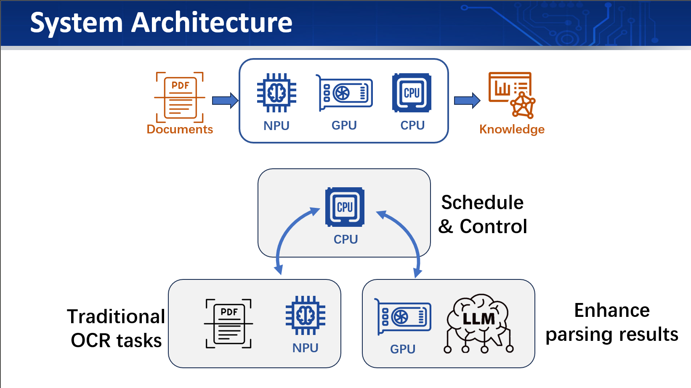
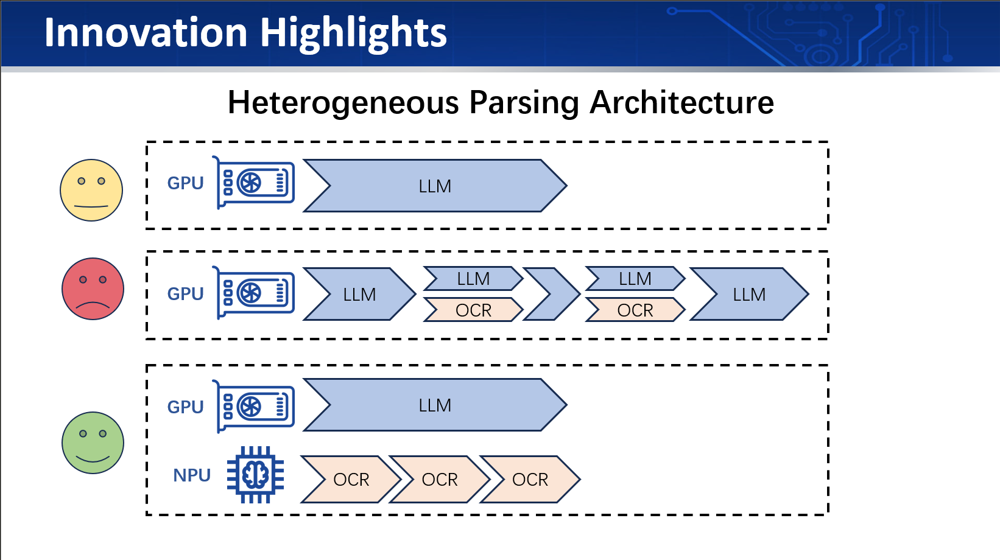
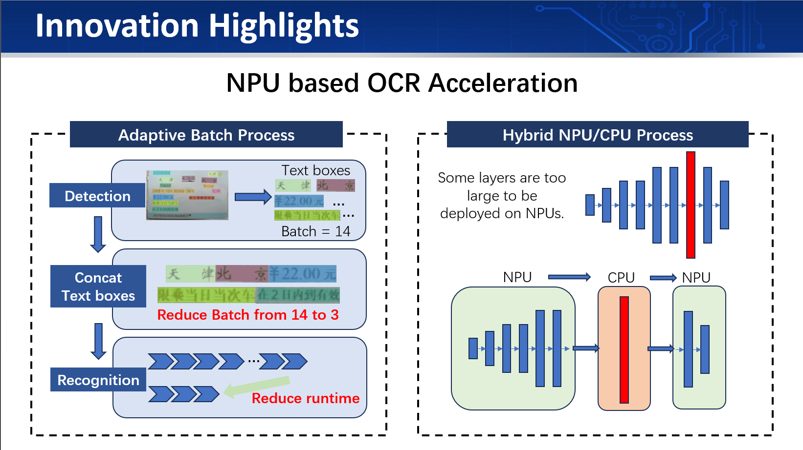
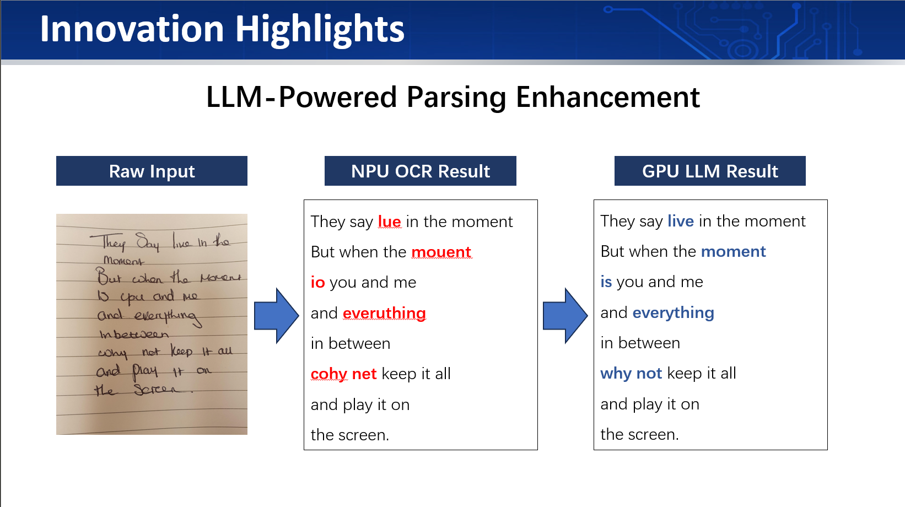
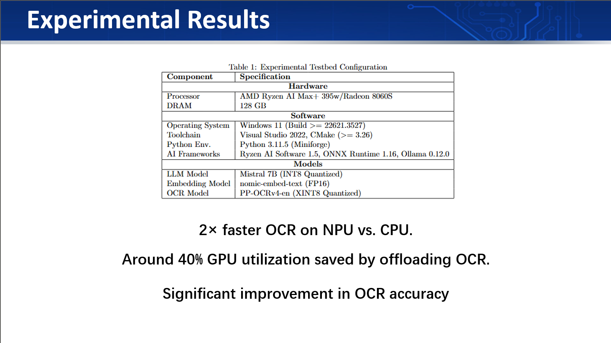
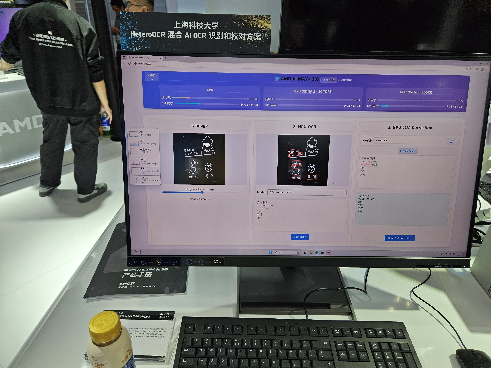

A heterogeneous computing system that integrates CPU, GPU, and NPU resources to accelerate OCR tasks. 

The system is designed to leverage the strengths of each processing unit to achieve high performance and efficiency in OCR applications.

# AMD HeteroOCR

## CIIE 2025

